

  <a href="https://github.com/BetterDefender"></a>

  

  
  
  
  

  红队攻防 · 武器化研究 · AI 安全 &nbsp;|&nbsp; <i>Break it. Understand it. Defend better.</i>

<h2 align="center"><samp>▍ 01 // WHOAMI</samp></h2>

  <a href="https://github.com/BetterDefender?tab=repositories"></a>

<h2 align="center"><samp>▍ 02 // ARSENAL</samp></h2>

<samp>// OFFENSIVE TOOLING</samp>

  
  
  
  
  
  
  
  

<samp>// LANGUAGES &amp; RUNTIME</samp>

  
  
  
  
  
  
  
  
  

<h2 align="center"><samp>▍ 03 // FEATURED WORK</samp></h2>

  <a href="https://github.com/BetterDefender/CodexHarbor">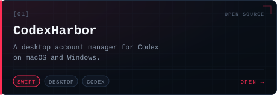</a>
  <a href="https://github.com/BetterDefender/revshell">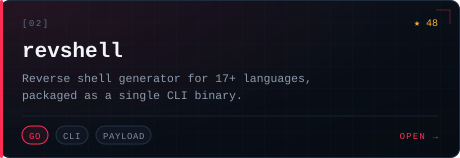</a>

  <a href="https://github.com/BetterDefender/AwvsBatchImport">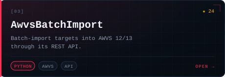</a>
  <a href="https://github.com/BetterDefender/SpringBootScan">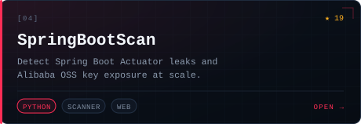</a>

  <a href="https://github.com/BetterDefender/PentestBox">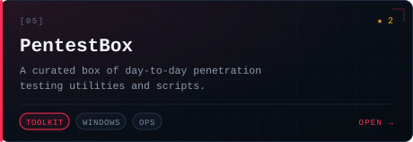</a>
  <a href="https://github.com/BetterDefender/anchorScan">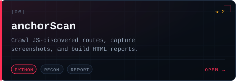</a>

  <a href="https://github.com/BetterDefender/API-Strike">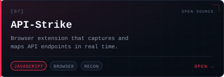</a>
  <a href="https://github.com/BetterDefender?tab=repositories">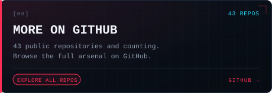</a>

<h2 align="center"><samp>▍ 04 // TELEMETRY</samp></h2>

  <a href="https://github.com/BetterDefender"></a>

<h2 align="center"><samp>▍ 05 // CONNECT</samp></h2>

  Focused on adversary simulation, offensive tooling, and AI × security. 
  专注于红队攻防、武器化研究与 AI 安全。

  

  All security research and testing are conducted under explicit authorization. · 所有安全测试均在明确授权下进行。

  <a href="https://github.com/BetterDefender"></a>

